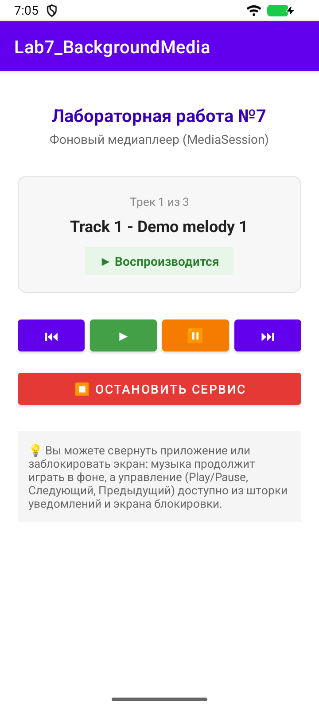
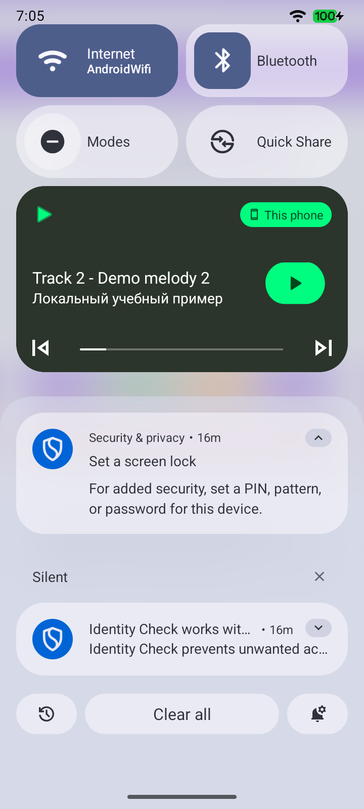
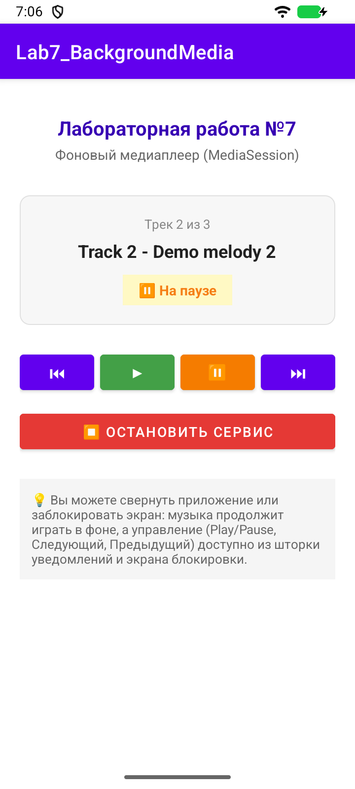
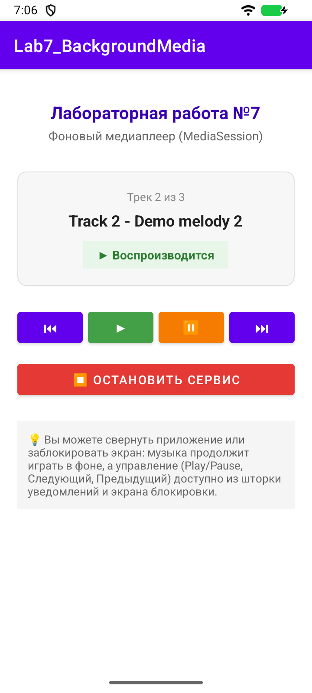

# Лабораторная работа 7

## Фоновый плейлист и MediaSession

Студент: Ретунский Савелий. Проверка: 10 ноября 2026 года.

## Цель

Воспроизводить плейлист в foreground service, синхронизировать UI и управлять через уведомление и системную медиасессию.

## Структура

MainActivity → Intent actions → MediaService → MediaPlayer / MediaSessionCompat / MediaStyle notification. MediaService → LocalBroadcastManager → BroadcastReceiver Activity. При onStart Activity отправляет ACTION_QUERY без запуска музыки.

## Реализация и исправления

1. Плейлист содержит три различимые локальные WAV-мелодии по 8 секунд. Исходные три MP3 были одинаковыми. Демозаписи созданы синтезом синусоид для проверки переходов и не требуют сети.

2. Next/Previous освобождают старый MediaPlayer и загружают выбранный ресурс. Ручной переход за границу зациклен. По завершении трека автоматически запускается следующий; после последнего сервис останавливается.

3. Сервис объявлен с foregroundServiceType="mediaPlayback" и нужными разрешениями. Foreground-уведомление создаётся до обработки команд, включая Pause/Stop до первого Play.

4. MediaSession получает PlaybackState с поддерживаемыми действиями, позицией и скоростью, а также MediaMetadata с названием, автором и длительностью. Это позволяет системным медиаконтроллерам управлять активной сессией.

5. MediaStyle-уведомление содержит название, автора и Previous/Play-Pause/Next. Экран получает состояние, название и номер трека; при повторном открытии запрашивает актуальное состояние. На ошибках плеер и сервис освобождаются.

## Проверка

Сборка `assembleDebug assembleDebugAndroidTest lintDebug`: успешно. Android Lint: 0 ошибок, 44 предупреждений. Предупреждения включают строки в XML вместо ресурсов, локализацию и рекомендации по зависимостям; они не скрыты baseline-файлом.

Эмулятор: Medium Phone, Android 16 API 36.1, x86_64. Тест `LabRegressionTest`: пройден. Исходник теста: [LabRegressionTest.kt](../app/src/androidTest/java/com/example/lab7_backgroundmedia/LabRegressionTest.kt).

`connectedDebugAndroidTest` в этой Windows-среде не запустил Gradle Worker (`GradleWorkerMain` не найден). Те же собранные тестовые APK запускались через `adb shell am instrument -w …/androidx.test.runner.AndroidJUnitRunner`. Для повторения: `./verify.ps1 -DeviceTests` на отдельном эмуляторе. Скрипт очищает учебные данные приложения на эмуляторе.

Лог запуска:

```text
com.example.lab7_backgroundmedia.LabRegressionTest:.

Time: 31.265

OK (1 test)
```

## Скриншоты сценариев

### 01-pause-before-play


### 02-playing



### 03-next-paused


### 03-notification



### 04-restored-state



### 05-controller-previous


### 06-auto-next



### 07-stopped


## Фрагменты кода

### TrackInfo.kt

[Полный исходник](../app/src/main/java/com/example/lab7_backgroundmedia/TrackInfo.kt)

```kotlin
data class TrackInfo(
    val resId: Int,
    val title: String,
    val artist: String
)
```

### MediaService.kt

[Полный исходник](../app/src/main/java/com/example/lab7_backgroundmedia/MediaService.kt)

```kotlin
override fun onStartCommand(intent: Intent?, flags: Int, startId: Int): Int {
        if (intent?.action == ACTION_QUERY) {
            sendState(currentState, currentTrack.title)
            if (!foreground) stopSelf(startId)
            return START_NOT_STICKY
        }
        // Every foreground-service launch must promote promptly, even Pause/Stop
        // pressed before the first Play. Loading resources happens afterwards.
        if (!foreground) {
            startForeground(NOTIFICATION_ID, buildNotification(currentTrack.title, "Готов к воспроизведению", false))
            foreground = true
        }
        try {
            when (intent?.action) {
                ACTION_PLAY -> play()
                ACTION_PAUSE -> pause()
                ACTION_STOP -> stopAndDestroy()
                ACTION_NEXT -> next()
                ACTION_PREVIOUS -> previous()
                else -> play()
            }
        } catch (error: Exception) {
            handlePlaybackError()
        }
        return START_NOT_STICKY
    }
```

### MediaService.kt

[Полный исходник](../app/src/main/java/com/example/lab7_backgroundmedia/MediaService.kt)

```kotlin
private fun loadCurrentTrack() {
        mediaPlayer?.release()
        mediaPlayer = null
        mediaPlayer = MediaPlayer.create(this, currentTrack.resId)
            ?: throw IllegalStateException("Не удалось открыть трек")

        mediaPlayer?.setOnCompletionListener {
            // Автопереход к следующему треку (Критерий задания)
            safely {
                if (currentIndex < playlist.lastIndex) {
                    currentIndex++
                    loadCurrentTrack()
                    play()
                } else {
                    stopAndDestroy()
                }
            }
        }

        mediaPlayer?.setOnErrorListener { _, _, _ ->
            handlePlaybackError()
            true
        }
    }
```

### MediaService.kt

[Полный исходник](../app/src/main/java/com/example/lab7_backgroundmedia/MediaService.kt)

```kotlin
private fun sendState(state: String, title: String) {
        currentState = state
        val playing = state == "playing"
        val sessionState = when (state) {
            "playing" -> PlaybackStateCompat.STATE_PLAYING
            "paused" -> PlaybackStateCompat.STATE_PAUSED
            "error" -> PlaybackStateCompat.STATE_ERROR
            else -> PlaybackStateCompat.STATE_STOPPED
        }
        mediaSession.setMetadata(MediaMetadataCompat.Builder()
            .putString(MediaMetadataCompat.METADATA_KEY_TITLE, title)
            .putString(MediaMetadataCompat.METADATA_KEY_ARTIST, currentTrack.artist)
            .putLong(MediaMetadataCompat.METADATA_KEY_DURATION, mediaPlayer?.duration?.toLong() ?: 0L)
            .build())
        mediaSession.setPlaybackState(PlaybackStateCompat.Builder()
            .setActions(PlaybackStateCompat.ACTION_PLAY or PlaybackStateCompat.ACTION_PAUSE
                or PlaybackStateCompat.ACTION_PLAY_PAUSE or PlaybackStateCompat.ACTION_STOP
                or PlaybackStateCompat.ACTION_SKIP_TO_NEXT or PlaybackStateCompat.ACTION_SKIP_TO_PREVIOUS)
            .setState(sessionState, mediaPlayer?.currentPosition?.toLong() ?: 0L, if (playing) 1f else 0f)
            .build())
        val intent = Intent(BROADCAST_STATE_CHANGED).apply {
            putExtra(EXTRA_STATE, state)
            putExtra(EXTRA_TITLE, title)
            putExtra(EXTRA_INDEX, currentIndex + 1)
            putExtra(EXTRA_TOTAL, playlist.size)
        }
        LocalBroadcastManager.getInstance(this).sendBroadcast(intent)
    }
```

### MediaService.kt

[Полный исходник](../app/src/main/java/com/example/lab7_backgroundmedia/MediaService.kt)

```kotlin
private fun buildNotification(title: String, text: String, isPlaying: Boolean): Notification {
        val prevIntent = PendingIntent.getService(
            this, 1,
            Intent(this, MediaService::class.java).apply { action = ACTION_PREVIOUS },
            PendingIntent.FLAG_UPDATE_CURRENT or PendingIntent.FLAG_IMMUTABLE
        )

        val playPauseAction = if (isPlaying) ACTION_PAUSE else ACTION_PLAY
        val playPauseIcon = if (isPlaying) android.R.drawable.ic_media_pause else android.R.drawable.ic_media_play
        val playPauseTitle = if (isPlaying) "Пауза" else "Играть"

        val playPauseIntent = PendingIntent.getService(
            this, 2,
            Intent(this, MediaService::class.java).apply { action = playPauseAction },
            PendingIntent.FLAG_UPDATE_CURRENT or PendingIntent.FLAG_IMMUTABLE
        )

        val nextIntent = PendingIntent.getService(
            this, 3,
            Intent(this, MediaService::class.java).apply { action = ACTION_NEXT },
            PendingIntent.FLAG_UPDATE_CURRENT or PendingIntent.FLAG_IMMUTABLE
        )

        val openAppIntent = PendingIntent.getActivity(
            this, 0,
            Intent(this, MainActivity::class.java),
            PendingIntent.FLAG_UPDATE_CURRENT or PendingIntent.FLAG_IMMUTABLE
        )

        val builder = NotificationCompat.Builder(this, CHANNEL_ID)
            .setContentTitle(title)
            .setContentText("${currentTrack.artist} — $text")
            .setOngoing(isPlaying)
            .setOnlyAlertOnce(true)
            .setSubText("${currentIndex + 1} из ${playlist.size}")
            .setSmallIcon(android.R.drawable.ic_media_play)
            .setContentIntent(openAppIntent)
            .setVisibility(NotificationCompat.VISIBILITY_PUBLIC)
            .addAction(android.R.drawable.ic_media_previous, "Назад", prevIntent)
            .addAction(playPauseIcon, playPauseTitle, playPauseIntent)
            .addAction(android.R.drawable.ic_media_next, "Вперед", nextIntent)
            .setStyle(
                androidx.media.app.NotificationCompat.MediaStyle()
                    .setShowActionsInCompactView(0, 1, 2)
                    .setMediaSession(mediaSession.sessionToken)
            )

        return builder.build()
    }
```

### MainActivity.kt

[Полный исходник](../app/src/main/java/com/example/lab7_backgroundmedia/MainActivity.kt)

```kotlin
override fun onStart() {
        super.onStart()
        LocalBroadcastManager.getInstance(this).registerReceiver(
            stateReceiver,
            IntentFilter(MediaService.BROADCAST_STATE_CHANGED)
        )
        // A normal start from the visible Activity asks for state without starting playback.
        startService(Intent(this, MediaService::class.java).setAction(MediaService.ACTION_QUERY))
    }
```

## Вывод

Сервис отделяет воспроизведение от жизненного цикла Activity. MediaSession передаёт системе действия и метаданные, MediaStyle связывает их с уведомлением, BroadcastReceiver обновляет экран. Для воспроизведения в фоне Activity может быть закрыта: сервис продолжает работать до конца плейлиста или Stop. Физическая гарнитура не подключалась; путь внешнего управления проверен системным media key event на эмуляторе.
